# BlockWorld Adventures — actual rendered gallery

Preview 01 is local development work; nothing was deployed. [Download the playable package](../../artifacts/adventures-v1/BlockWorld-Adventures-Preview-01.zip) and run `python3 preview.py`, then open `http://localhost:8000/adventures.html`. The package also includes an interactive gallery. [Read the full report](REPORT.md).

116 deterministic tests and 37 rendered/interaction checks pass. Mobile screenshots use Chromium viewport/touch emulation; physical Lenovo, iPhone and Safari performance remains unverified. The managed software renderer measured about 2 fps. Prefab buildings are closed exteriors with no accessible interiors.

## Village centre

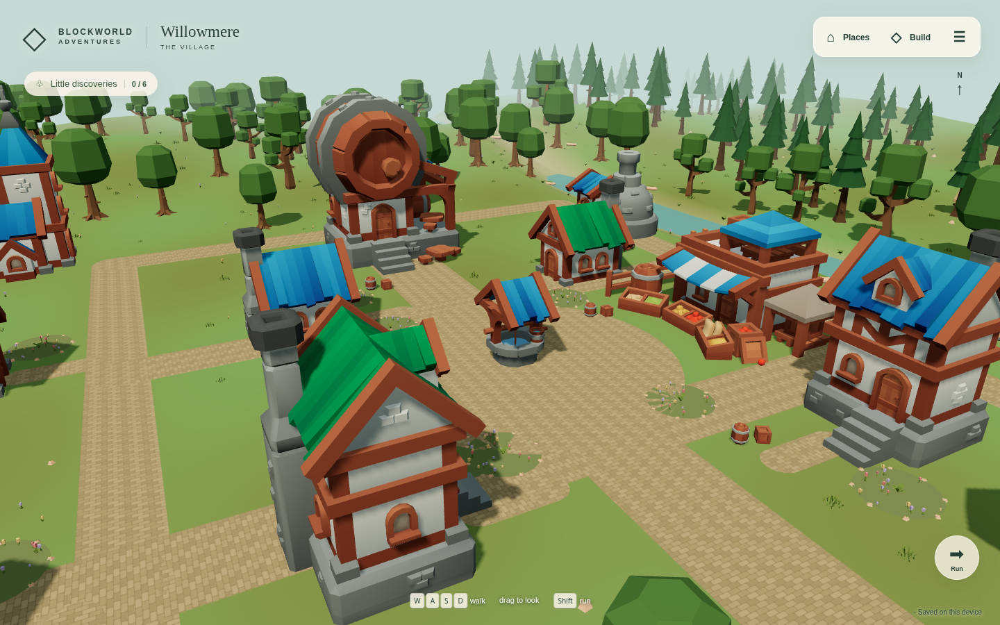

## Residential lane

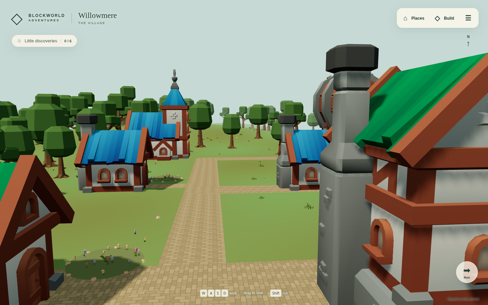

## Inn entrance — exterior only

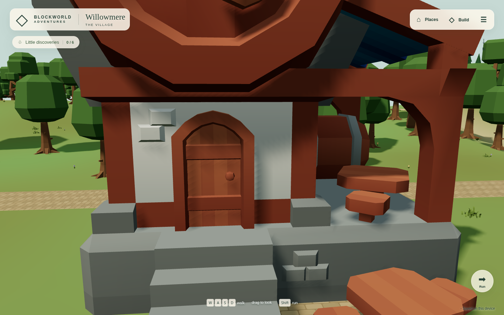

## Willowbrook bridge

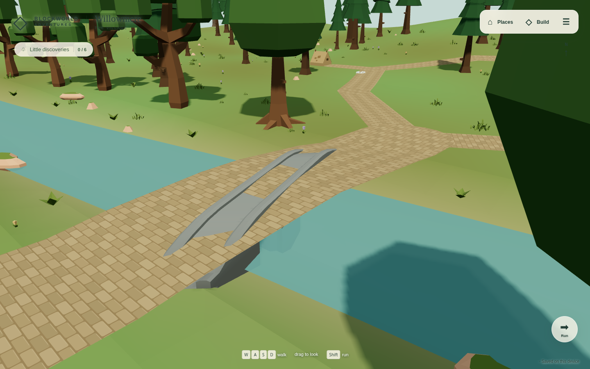

## Woodland edge

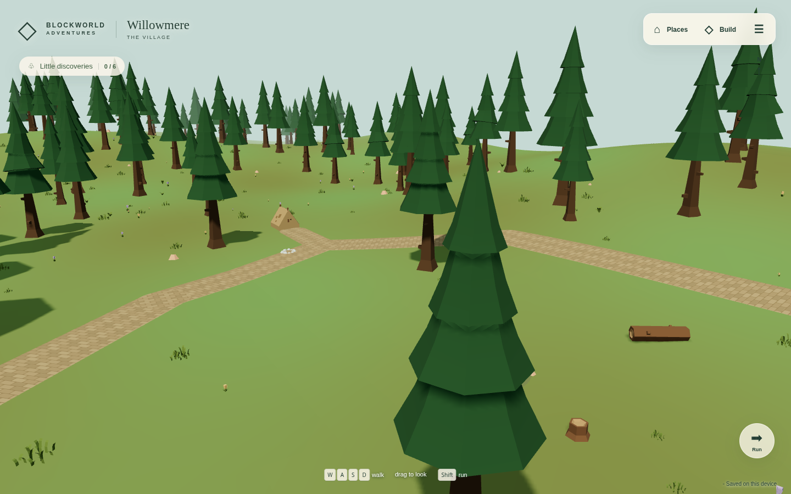

## Whispering Wood

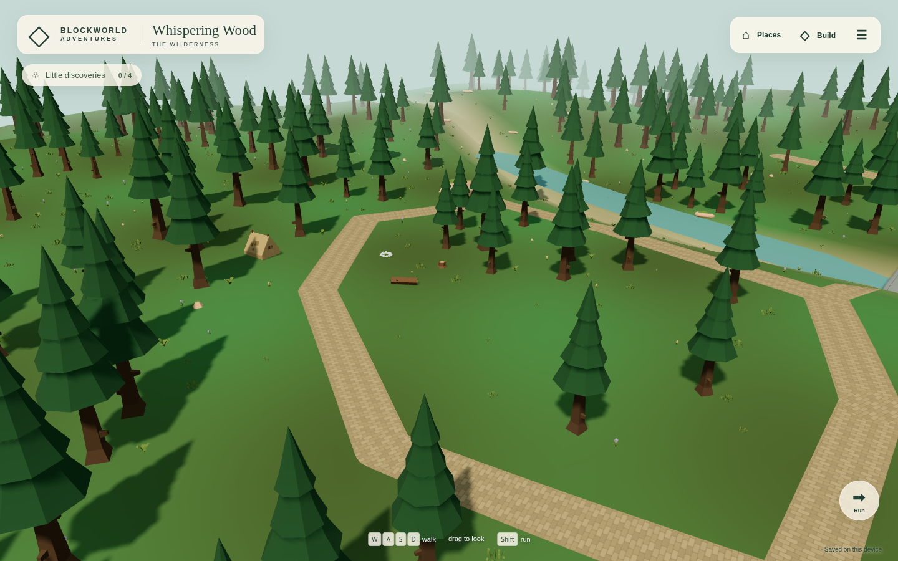

## Maker’s Meadow

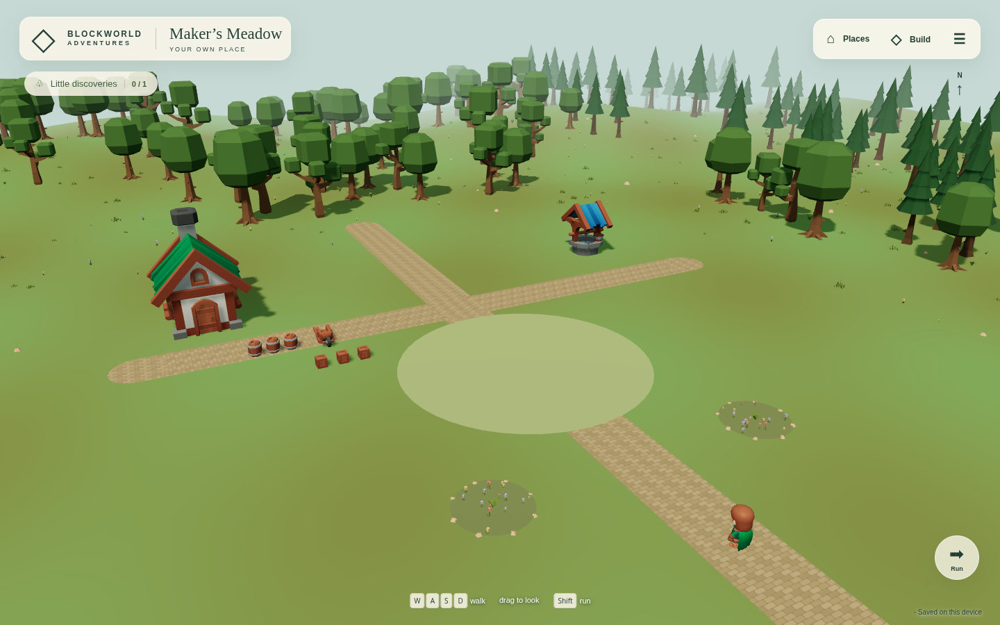

## Tablet player view — Chromium emulation

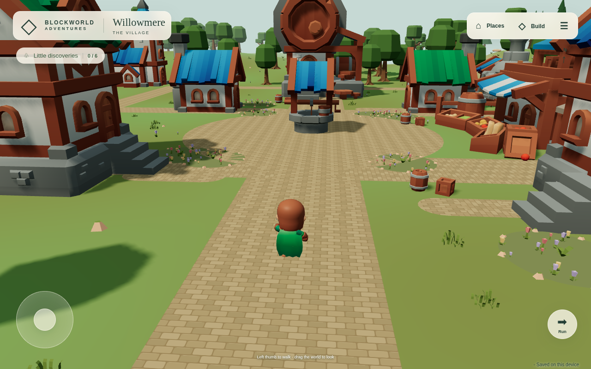

## Portrait phone player view — Chromium emulation

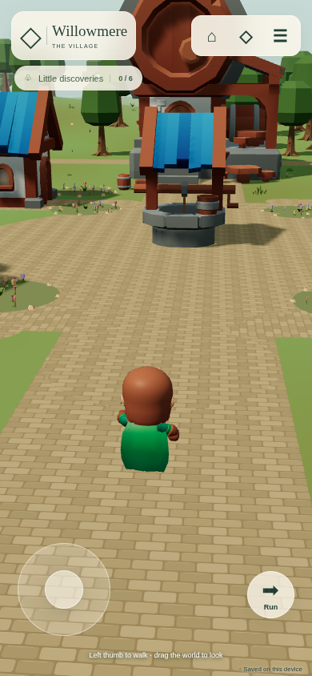

## Landscape phone player view — Chromium emulation

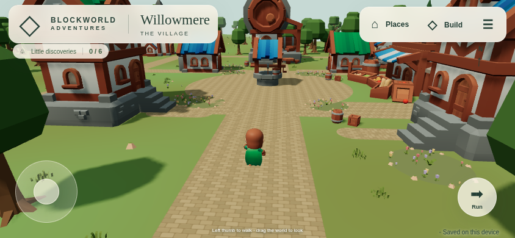

## World selection

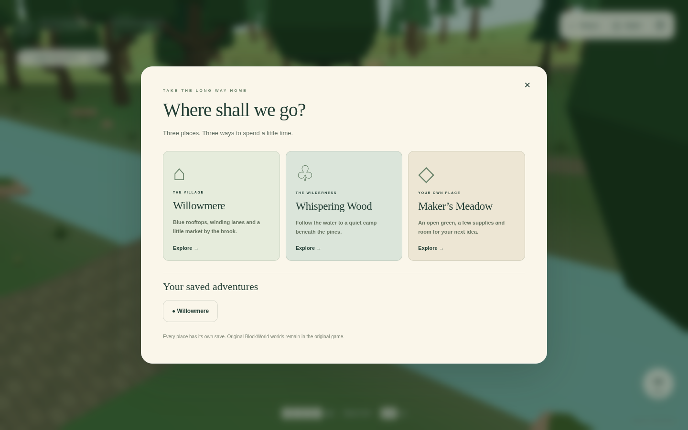

## Opening view

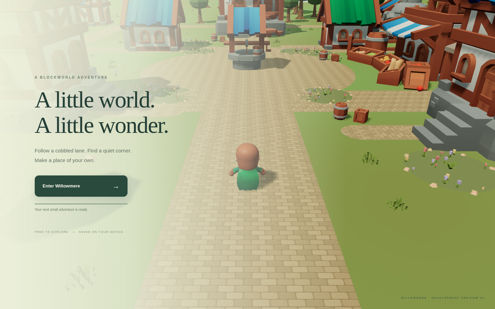
