# BlockWorld Adventures — Preview 02 gallery

Actual local browser renders. Nothing was deployed. [Preview package](../../artifacts/adventures-v2/BlockWorld-Adventures-Preview-02.zip) · [Full report](REPORT.md).

Physical Lenovo/iPhone and Safari performance remains unverified. Houses are exterior-only. Existing Preview 01 saves retain their original scene layout.

## Whispering Wood — Preview 01

Actual render of the original packaged scene.

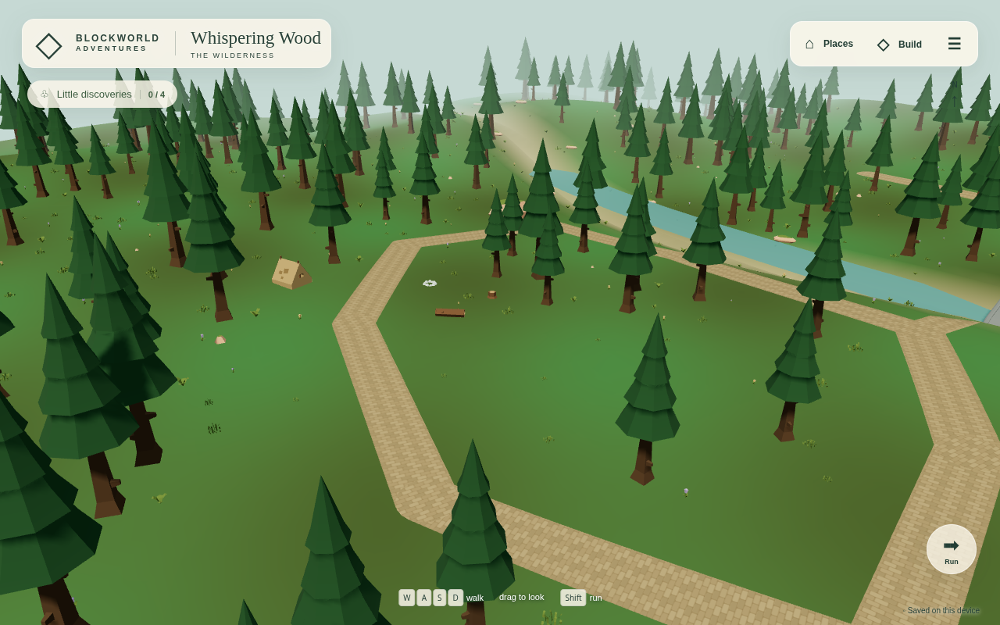

## Whispering Wood — new scenery

Curved earth trails, planted clearings, reeds and varied foliage; new layouts only.

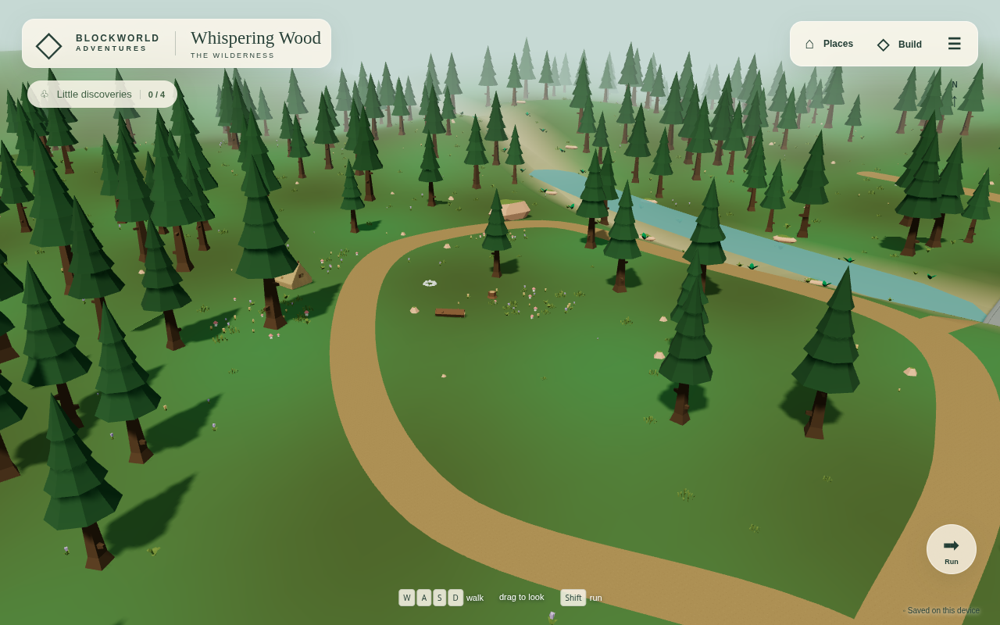

## Willowmere village centre

Premade houses, the well, market and connected streets.

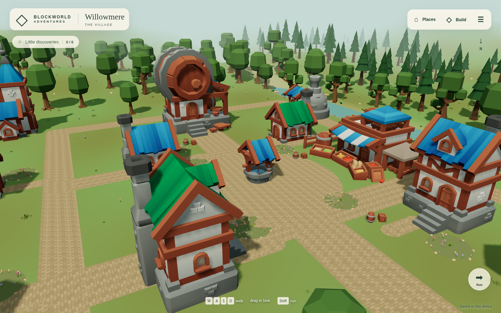

## Woodland at the village edge

The village’s outer trail now uses the earth material and softer turns.

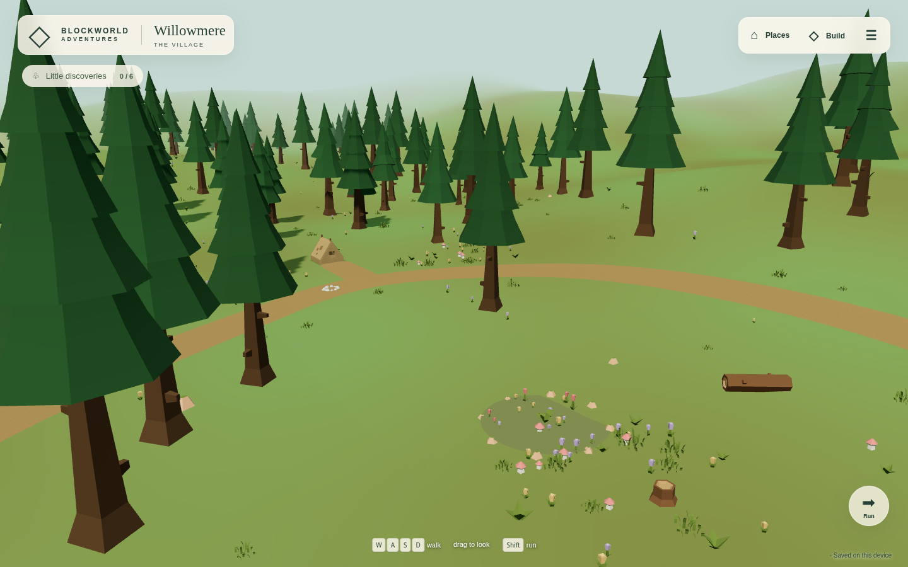

## Willowbrook bridge

The original premade deck stays clear and connects both banks.

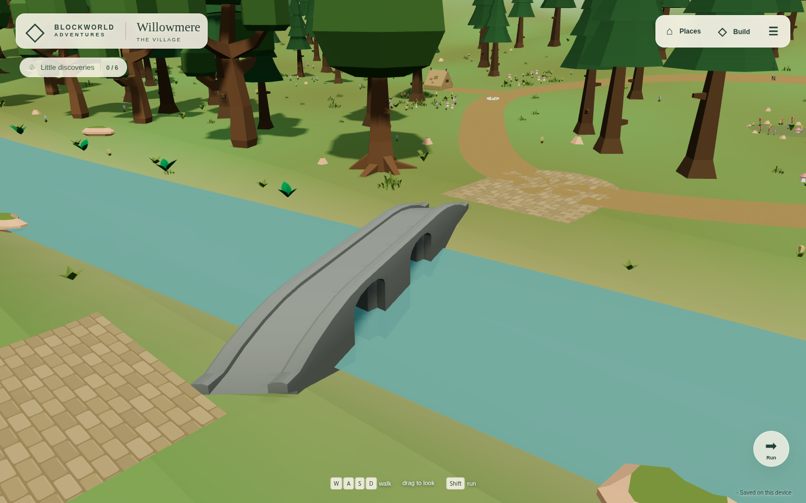

## Maker’s Meadow

An independent open construction area.

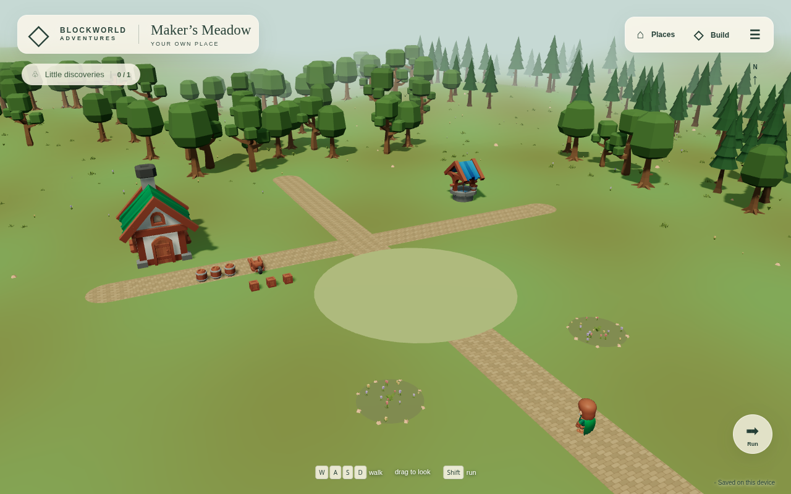

## Rendered asset catalogue

15 real model thumbnails, friendly names and category filters.

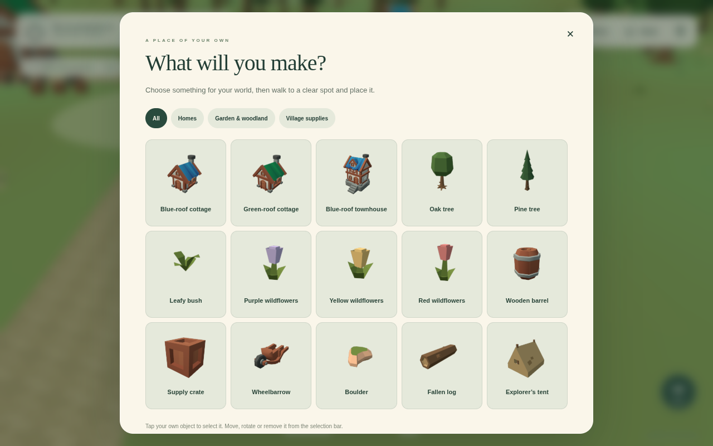

## Selection and editing

A visible outline marks the selected premade object.

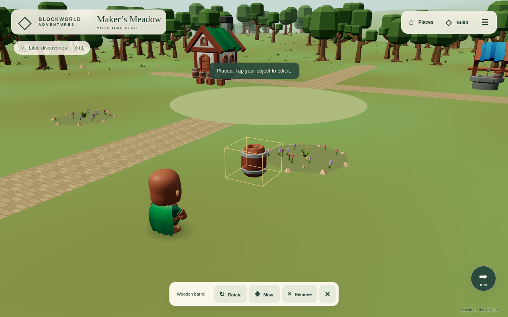

## Phone asset catalogue

390×844 Chromium touch emulation; the catalogue scrolls vertically.

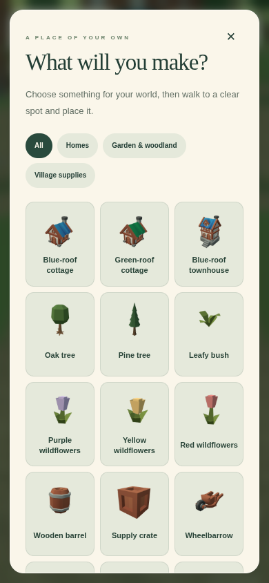

## Phone placement controls

Editing controls sit above the movement joystick.

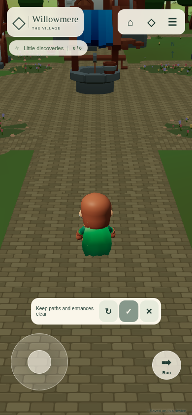

## Tablet asset catalogue

1280×800 touch emulation.

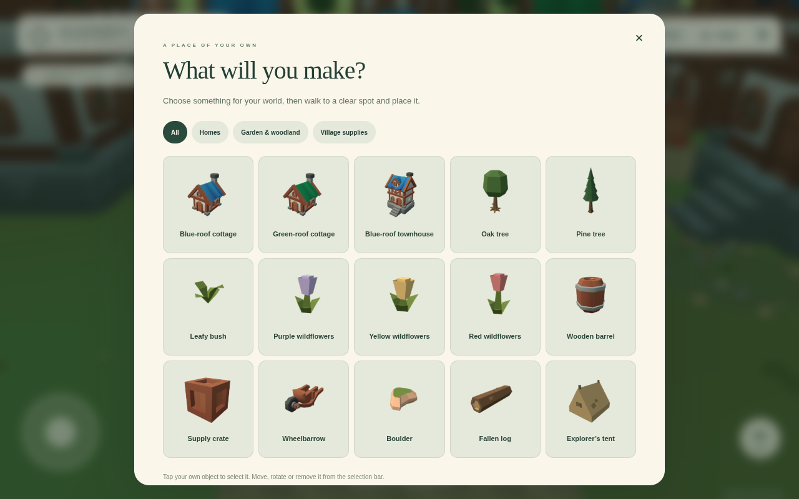

## Tablet player view

Walking, orbit and Run controls on the actual rendered scene.

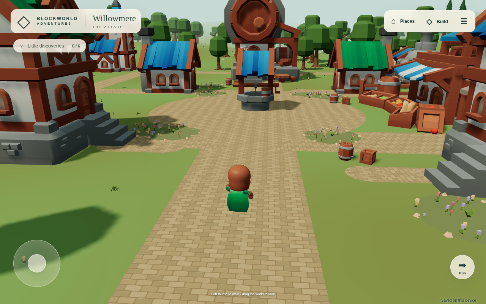

## Portrait phone player view

390×844 touch emulation.

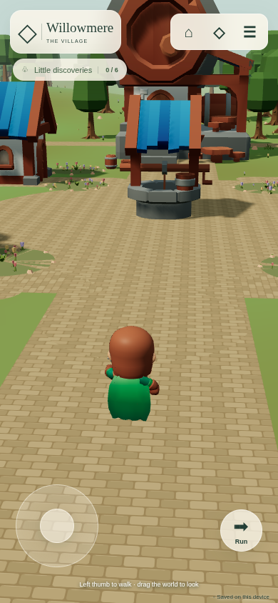

## Landscape phone player view

844×390 touch emulation.

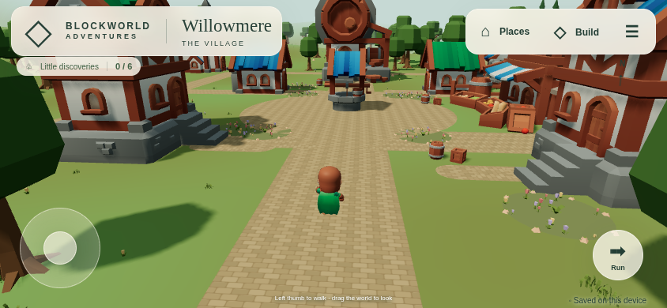

## Close-wall camera regression

The camera stays outside the inn; the nearby player body hides.

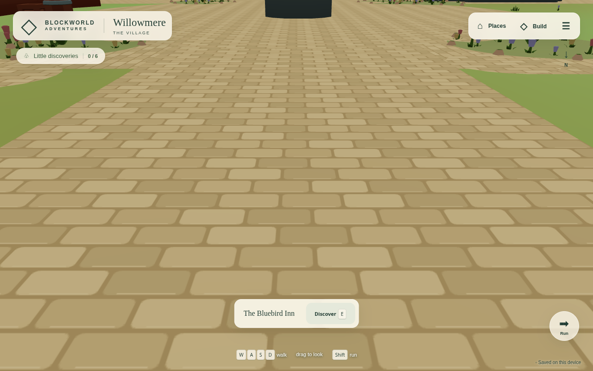

## Saved adventures and world selection

Existing saves retain their old scenery; fresh places use the latest layout.

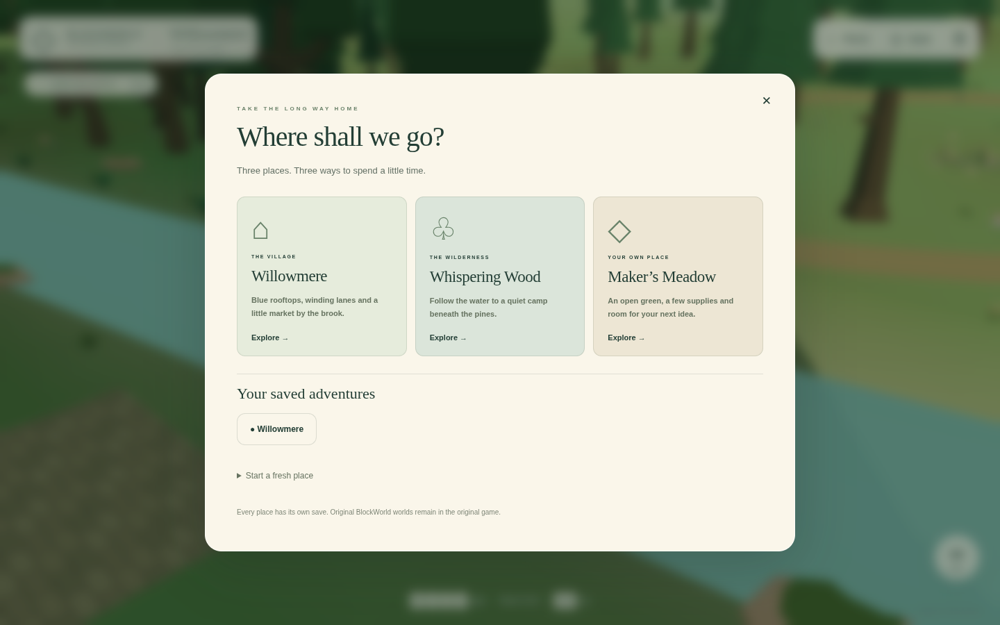
