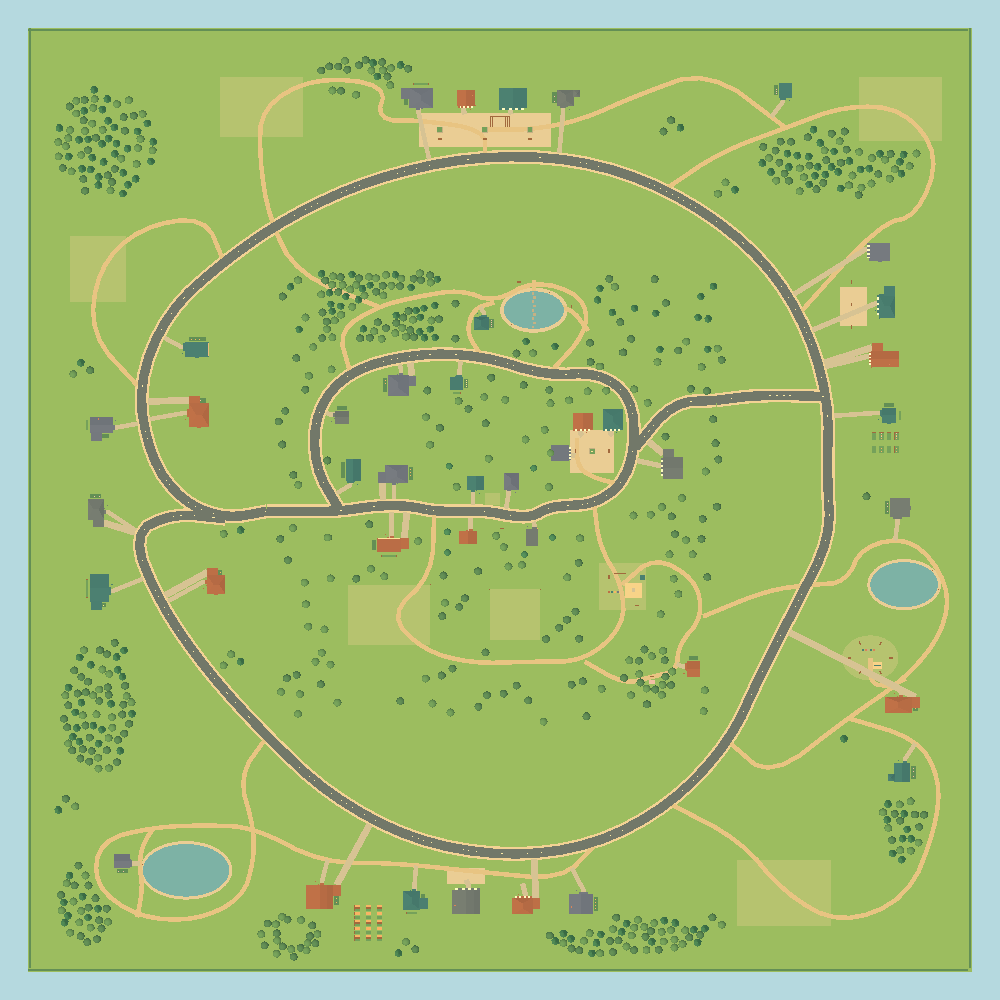
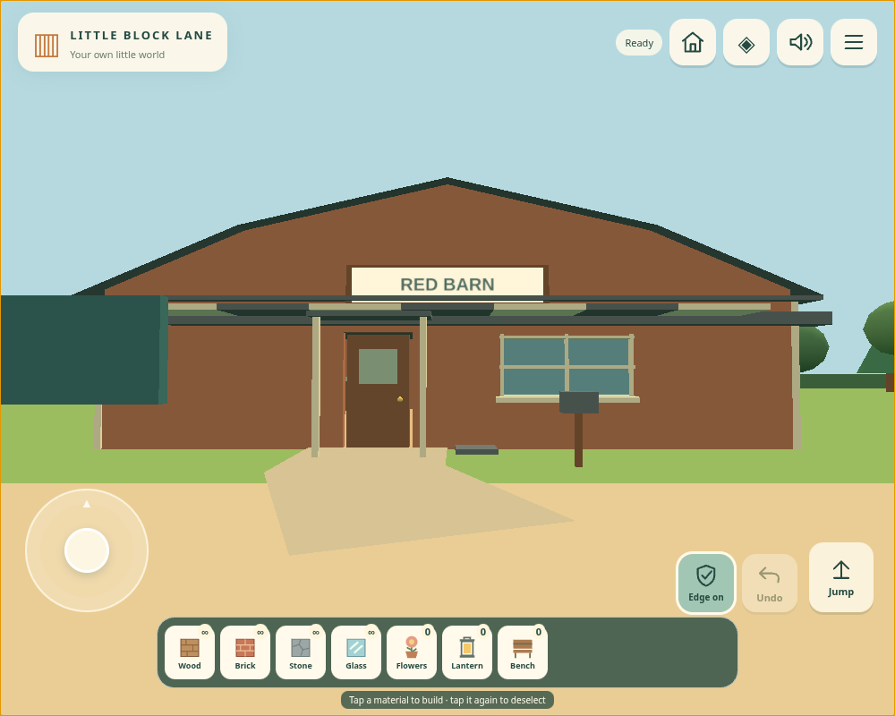
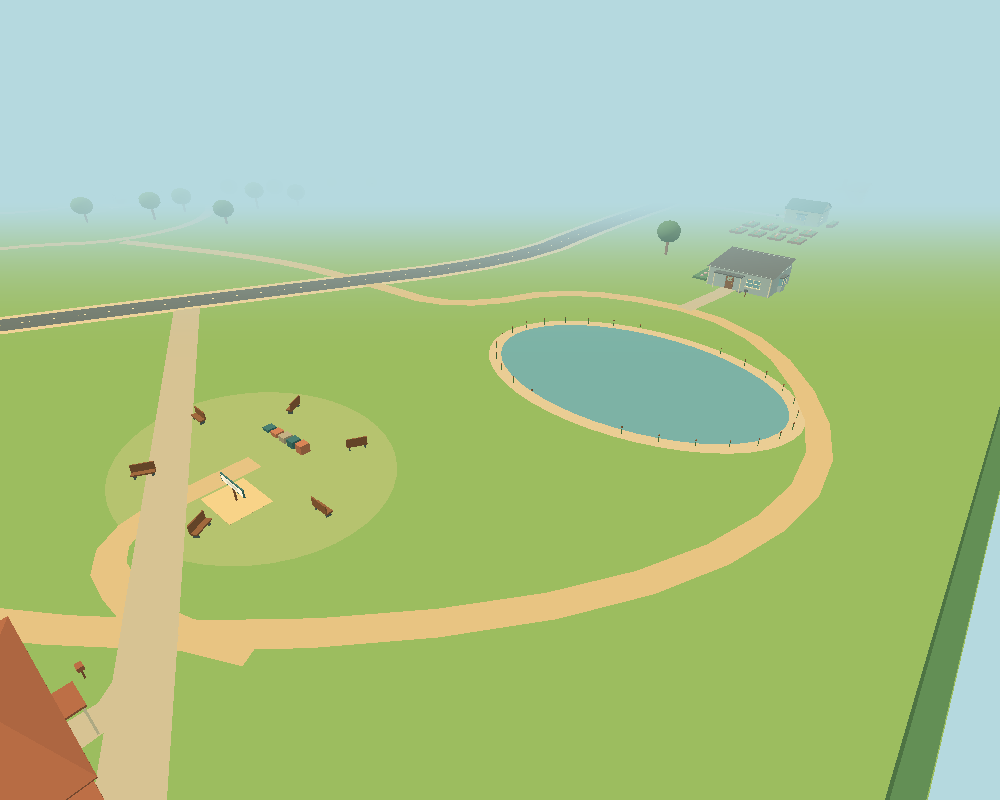

# Neighborhood 05 — final results

Client release date: 28 October 2026. **Experimental 05 does not replace stable playable 04.**

`BlockWorld_Neighborhood_05.html`: **590,892 bytes / 577.0 KiB**. SHA-256 `31567c3fa6df2679fc9dd87a32663eabc4345ca241882a51857301dd92a274b9`.

04 remains byte-for-byte unchanged, SHA-256 `7e57b8de5047233ce208f177a2d8a5861aba1653b7472a91fef5a389e71ffd48`. All 48 earlier root HTML files match the starting branch; see [preservation](preservation.json).

## What was built

500 × 500 metres, four times 04's land area; 40 primary buildings (16 retained + 24 new), three ponds, 15 landmarks, six building clearings and seven new grove areas. The new outer residential loop connects Sunbeam village, Makers village, Lake park, Red Barn farm, Reed pond and Beacon walk. The world has 603 trees including the original twelve.

Architecture adds bay projections, attached wings, open carports, broad porches, chimneys, tower silhouettes and gambrel barns. Closed auxiliary volumes are scenery; primary rooms have working doors. Terrain/water remain simple and level, and no NPCs, quests, swimming or parental gate were added.

## Functional verification

- **34 deterministic tests passed**: retained controls, 500 m limits, all doors, thin-wall collision, edge guard, jump height, all three speeds, generation/layout, connected routes, exact old-layout preservation, no new solid in 04's buildable region, save validation, chunk identity, exposed-face meshing and crafted preview/picking.
- **18 mobile browser scenarios passed**, with **1,323 real touch-point activations** at centres, edges and rounded-corner interiors. Viewports: 390×844, 844×390, 428×760 (DPR 3 / scaled menu), 800×600. Point probes isolate click delivery; separate end-to-end cases execute actions.
- All **40 doors × both sides** were checked for automatic/manual operation, partial/full swing, passage, delayed closing, closed-leaf obstruction and reopening. Fast approach is tested at every building. Bulk browser cases advance the actual runtime controller using simulated time/poses; physical-device passage is not claimed.
- **Nine save/navigation scenarios passed**, including a real 04 export containing 12,000 pieces, automatic copying into 05, preference/reopen checks, new outer coordinates, real 05 download/import, malformed-data rejection without mutation, manual 04/03 imports, unchanged old keys/settings and Home from the far meadow.
- **Six pixel-equality checks passed** for the fog visibility optimisation. Final browser, save, visual, fog and performance reports all identify the delivered HTML hash.
- Standalone code runs with the browser network disabled and no external runtime assets. Managed Chromium blocked the extra `file://` smoke test with `ERR_BLOCKED_BY_ADMINISTRATOR`; its policy was not changed. Actual local-file/device testing remains outstanding.

## Direct 04 → 05 comparison

**Linux Chromium 154.0.8037.57 / ANGLE SwiftShader software GPU, not iPhone or Lenovo.** Same 800×600 viewport, DPR 1, Gentle quality, Normal speed, FOV/fog/view range and fixture coordinates. Shared GPU warm-up precedes balanced **04 → 05 → 05 → 04** runs. Each view settles for 1.2 s and samples 5 s, giving two samples / approximately 10 s per version and view. FPS pools frame counts/elapsed time; p95 pools raw intervals. No other browser workload ran during profiling.

Each cell below is **04 → 05**. These short observations include scheduling, cache and GC variation; they do not establish sustained device smoothness.

| Shared view | Average FPS | p95 frame ms | Draw calls | Submitted triangles |
| --- | ---: | ---: | ---: | ---: |
| Original Home | 21.2 → 21.3 | 100.0 → 83.3 | 57 → 53 | 18,755 → 19,665 |
| Original village | 30.6 → 27.7 | 66.6 → 66.7 | 47 → 61 | 11,277 → 17,128 |
| Original woodland | 37.6 → 31.7 | 50.1 → 66.6 | 7 → 52 | 5,166 → 12,973 |
| Original meadow, west | 40.9 → 33.8 | 50.0 → 66.6 | 16 → 56 | 3,596 → 15,715 |
| 12,000-piece dense build | 21.6 → 21.1 | 83.4 → 83.3 | 28 → 58 | 10,246 → 19,333 |

Home and the dense build are close to 04 in this renderer. Woodland and meadow views include newly visible outer scenery and are more expensive. The measurements do not isolate world dimensions from the content now visible beyond the former boundary.

| Loading / memory indicator | 04 | 05 |
| --- | ---: | ---: |
| Document → ready, median of two warmed starts | 617 ms | 651 ms |
| First frame after game boot, median | 394 ms | 483 ms |
| Sampled JS heap in shared views | 16.8–29.5 MB | 29.3–39.3 MB |
| 12,000-piece validation / scene reconstruction, median | 385.8 ms | 361.7 ms |

JS heap excludes some graphics/native allocations and is not GPU memory. GPU-memory measurement is unavailable. Geometry/texture counters are recorded in the raw report; GPU uploads are lazy, so initial counts are not a peak memory budget. These warmed startup observations are not cold-device loading times.

### Building responsiveness

Browser CPU elapsed milliseconds, **median (range)** over six ordinary operations per version. These are actual gameplay function paths, not physical touch-to-display latency.

| Operation | 04 ms | 05 ms |
| --- | ---: | ---: |
| Place | 1.8 (0.7–3.4) | 1.0 (0.7–3.4) |
| Remove | 1.2 (0.8–4.7) | 1.7 (0.8–6.1) |
| Undo | 1.1 (0.6–1.2) | 0.7 (0.5–0.9) |

For the dense fixture, removal was **36.0–76.5 ms in 04**, **35.9–68.5 ms in 05**. Undo was **39.7–55.3 ms in 04**, **23.9–55.2 ms in 05**. Each operation rebuilt only the edited chunk; the other populated chunk retained its mesh identity.

This fixture is a 25×20×24 solid build, with roughly 9,000 blocks in the edited chunk. Hidden-face meshing makes its GPU workload different from many isolated blocks, thin walls or abundant furniture. These results do not bound every possible 12,000-piece arrangement. Synchronous dense-chunk edits can still cause a visible pause.

### New destinations, 05 only

These positions are outside 04's bounds, so no artificial 04 comparison is supplied. One five-second sample each.

| View | FPS | p95 ms | Calls | Triangles |
| --- | ---: | ---: | ---: | ---: |
| sunbeam-square | 31.0 | 66.7 | 24 | 6,889 |
| reed-pond | 41.3 | 50.0 | 40 | 9,953 |
| far-open | 37.3 | 50.1 | 42 | 10,424 |

## Scaling decision

Land area grew 4×, while primary building count grew 2.5× and static triangles approximately 2.45×. This experiment does not represent four times the content at 04's density.

The scene retains all 375 static chunks / 98,880 static triangles, collision data and player structures. Static geometry batching, spatial queries, local block edits and instanced furniture remain. Full visible detail is retained; streaming and LOD are not justified by this experiment alone.

Profiling exposed draw submissions for completely fogged chunks. A conservative view-depth/bounding-sphere check removes that invisible work. Same-frame comparison on the final artifact:

| View | Calls before → after | Triangles before → after | PNG pixels |
| --- | ---: | ---: | --- |
| home | 72 → 53 | 25,411 → 19,665 | identical |
| village | 74 → 61 | 20,737 → 17,128 | identical |
| woods | 52 → 52 | 12,973 → 12,973 | identical |
| open | 75 → 56 | 17,241 → 15,715 | identical |
| north | 24 → 24 | 6,889 → 6,889 | identical |
| east | 53 → 42 | 12,624 → 10,424 | identical |

The before-culling paired report is included as a separately hashed pre-release implementation, not a measurement of this delivered file. Memory remains resident; this optimisation is not streaming.

## Limits and next step

- No actual iPhone/Lenovo performance, thermal stability, file-opening success or user visual approval is claimed.
- Larger exposed views cost more rendering work; resident geometry, textures, startup construction and scene traversal grow with content.
- Dense build edits still mesh synchronously. If device tests show build hitches, profile smaller build chunks or incremental meshing first.
- Keep 04 stable. Test 05 on both devices at Gentle quality over a full exploration route and a real build before another expansion. Investigate generation/streaming only if measured startup or memory limits justify it; preserve visible detail unless a demonstrated geometry bottleneck warrants a separate LOD experiment.

[Device checklist](../WORLD_05.md) · [Architecture / reproducibility](../VERIFICATION_05.md) · [Raw comparison](performance.json) · [CSV](comparison.csv)

## Screenshots

Browser renders, not physical-device captures. The full survey is orthographic with fog disabled only for inspection, north at the top. Gameplay keeps its existing fog/view range.

[West homes](screenshots/west-overview.png) · [Sunbeam village](screenshots/north-overview.png) · [Farm](screenshots/farm-overview.png) · [Lake park](screenshots/lake-overview.png) · [Updated map](screenshots/map.png)

