# Neighborhood 06 — release results

28 October 2026. **06 is a new candidate for device testing; earlier standalone versions remain unchanged.**

[BlockWorld_Neighborhood_06.html](../../../BlockWorld_Neighborhood_06.html): **612,581 bytes / 598.2 KiB**, SHA-256 `db94d70972a654dbc155b0a294a3d0f56e98726ec888fbe0c342276ee469b60b`. Branch `codex/neighborhood-06-town`, based on 05 commit `4872cd7`.

All **49 previous root HTML files** match the starting branch byte for byte. [Preservation report](preservation.json). 05 SHA-256: `31567c3fa6df2679fc9dd87a32663eabc4345ca241882a51857301dd92a274b9`.

## New town content

Same 500 × 500 m world; **72 main buildings** (40 retained + 32 new), **12 functional roller-door garages**, six stair-equipped residences, accessible side wings, **17 building opportunities** (11 frontage properties + six larger clearings), three ponds and 18 landmarks. Linden and Willow are opposing residential frontages; Elm is a smaller western lane. Magnolia manor, library, café and workshop add destinations. The farm, villages, old neighbourhood, ponds and reserves remain recognisable. Parks have grouped equipment, connected paths, sensible seating and picnic shelters.

The circular minimap shares a cached town map with the full-screen map, updates at most 10 Hz after movement/turning, and opens the full map on tap. Contextual interactions sit in a right-side dock above actions. Touch building, inventory/crafting, previews, rotation, Undo, edge protection, Jump, speeds and browser persistence are retained. Standard browser Xbox-style input has been added and tested with simulated input.

## Functional and visual verification

- **41 deterministic tests pass**: retained movement/building/Undo/save controls; every door; safe roller closing; stairs and connected rooms; bounds, geometry, lots, tree trunks, entrance/trail clearance, road marking junctions, imports, 12,000-piece saves, gamepad axes/button edges, and preserving old creations against new properties/relocated scenery.
- **18 browser regression scenarios pass**, including **735 touch activations** at button centres and four edge midpoints across gameplay, hotbar, settings, crafting, map and preview controls. Four profiles: 390×844, 844×390, 428×760 (DPR 3 / scaled menu), 800×600. Probes isolate delivery; separate cases execute gameplay actions.
- **10 new-feature browser scenarios pass**: real 05 migration/reopen at a new property and moved bench, cache/heading behaviour, minimap/full map, all six staircases in the runtime, rendered town/interior captures, dock clearance and central camera drags at four sizes, plus keyboard, mouse and simulated Gamepad API events. Minimap radial touches add 20 activation checks.
- **Nine save/navigation scenarios pass**, plus a separate direct 04 → 06 schema-2 migration/reopen test using another real 12,000-piece runtime build. The main save suite includes real 05 export/download with 12,000 pieces, copy to 06, preference persistence, 06 export/import through file inputs, invalid import rejection without mutation, manual earlier imports, unchanged old keys and Home.
- All **84 doors × both sides** are exercised for automatic/manual operation, animation, passage, closed collision, delayed closing and reopening. Fast approaches are tested at every door; all 12 rollers refuse placed-piece obstructions and returning players. Bulk passage tests advance the actual runtime using simulated poses/time.
- The [geometry audit](geometry.json) checks 411 unique geometries and 7,791 box instances: finite attributes/bounds and positive box dimensions.
- **Six exact PNG comparisons pass** with fog visibility culling enabled/disabled. Screenshot inspection covers town overview, streets, lots, parks, manor/interiors, stairs, bay-window correction, garages and the touch dock.
- The standalone document runs with networking disabled and no external assets. Real downloads/file-input operations pass. The separate local `file://` smoke test is blocked by managed Chromium policy; the policy was not changed. **Physical Lenovo/iPhone, controller pairing and real local-file execution remain unverified.**

## Direct 05 → 06 performance comparison

Linux Chromium **154.0.8037.57 / ANGLE SwiftShader software GPU**. Same 800×600 viewport, DPR 1, Gentle quality, Normal speed, camera poses, fog/FOV and build fixture. Shared GPU warm-up; balanced **05 → 06 → 06 → 05** order. Each view settles 1.2 s and samples 5 s; two runs give about ten seconds per version/view. No other browser workload runs during this profiling. FPS pools frames/elapsed time and p95 pools raw frame intervals.

Each cell is **05 → 06**. Linden/Willow use identical coordinates, which are largely open in 05 and developed in 06; the content difference is intentional. Short software-renderer samples include GC/scheduling variation and do not establish sustained mobile smoothness.

| Shared camera view | Average FPS | p95 frame ms | Draw calls | Submitted triangles |
| --- | ---: | ---: | ---: | ---: |
| Home | 21.2 → 19.3 | 83.4 → 83.4 | 53 → 83 | 19,665 → 35,178 |
| Original village | 27.8 → 24.3 | 66.7 → 66.7 | 61 → 84 | 17,128 → 31,936 |
| Original woodland | 31.7 → 27.3 | 66.6 → 66.7 | 52 → 56 | 12,973 → 19,315 |
| Linden Street | 43.4 → 26.7 | 50.0 → 66.7 | 43 → 55 | 10,144 → 20,806 |
| Willow Street | 45.5 → 27.6 | 50.0 → 66.7 | 37 → 54 | 10,578 → 20,343 |
| Open meadow, west | 33.5 → 32.7 | 50.1 → 66.6 | 56 → 51 | 15,715 → 17,800 |
| 12,000-piece build | 20.8 → 21.1 | 83.3 → 83.3 | 58 → 55 | 19,333 → 22,011 |

| Loading / memory indicator | 05 | 06 |
| --- | ---: | ---: |
| Document → ready, median of two warmed starts | 1917 ms | 960 ms |
| First frame after game boot, median | 1629 ms | 774 ms |
| Sampled JavaScript heap in shared views | 19.6–37.9 MB | 24.2–46.4 MB |
| 12,000-piece validation / scene reconstruction, median | 392.4 ms | 416.4 ms |

Only two warmed starts were sampled per version; the raw ready times range from 760–3073 ms in 05 and 913–1008 ms in 06. This does not establish a consistent loading-speed improvement.

Heap excludes native/GPU allocations and some graphics storage. Total GPU memory is unavailable. Renderer geometry/texture counters are in [raw performance](performance.json); uploads are lazy, so startup counts are not a peak memory budget. These are warmed browser starts, not cold-device measurements.

### Building response

CPU elapsed milliseconds, median (range), six ordinary operations per version. These use actual gameplay handlers, not physical finger-to-display latency.

| Operation | 05 ms | 06 ms |
| --- | ---: | ---: |
| Place | 0.9 (0.8–3.3) | 2.4 (1.1–3.6) |
| Remove | 0.9 (0.8–6.0) | 2.6 (0.9–32.3) |
| Undo | 0.6 (0.6–1.0) | 1.1 (0.5–1.9) |

Dense removal: **25.1–79.7 ms in 05**, **44.8–72.2 ms in 06**. Dense Undo: **38.3–55.3 ms in 05**, **16.9–55.7 ms in 06**. Every action rebuilds only its edited build chunk; the other populated chunk retains mesh identity.

The stress fixture is a solid 25×20×24 build, with roughly 9,000 pieces in the edited chunk. Hidden-face meshing makes it different from many isolated blocks, thin walls or abundant furniture. These results do not guarantee smoothness for every possible 12,000-piece arrangement; synchronous dense edits can still pause.

### Moving through the town

A separate balanced 05 → 06 → 06 → 05 run holds the actual keyboard movement input for five seconds per view, at Normal on Linden and Fast on Willow. The 06 minimap updates during movement. Same 800×600/Gentle conditions, with no competing browser. Traversal distance is asserted and raw position, calls/triangles/heap samples and frame intervals are retained in [motion data](motion.json). These are simulated desktop-browser walks, not physical touchscreen latency or hardware tests.

| Moving view | Average FPS 05 → 06 | p95 ms 05 → 06 |
| --- | ---: | ---: |
| linden-walking | 48.0 → 27.3 | 33.4 → 66.7 |
| willow-fast | 53.7 → 29.7 | 33.3 → 66.7 |

## Architecture and limitations

The default 06 town contains **407 static chunks / 135,751 static triangles**, versus 375 / 98,880 in 05. Main buildings increase 80%; static triangles increase approximately 37%. Static batching, shared geometry, collision indexes, full-fog culling, instanced crafted parts and local block-edit rebuilding remain. Complete geometry/collision data stays resident; no streaming or LOD is introduced.

Profiling also removed repeated whole-save validation: a preliminary 06 restore measured about 617 ms; the final median is 416 ms in the same harness. Structural, piece-overlap, inventory and indexed static-collision checks remain, and rejection stays atomic.

Door leaf batching reduces 324 individual meshes to 84 animated leaves sharing three geometries. A preliminary Home view fell from 155 to 83 calls after batching; final counts are in the paired table. Idle doors defer broadphase queries until a request/animation needs them. The minimap reuses a static 1024² cache and avoids world-map drawing on idle frames.

Terrain remains flat, water decorative, playground equipment fixed, and many retained cottages remain one-room homes. Towers are solid clock landmarks. The maps show built-in town objects, not player-placed pieces. Importing an older creation may omit new buildings/scenery; new street surfaces can run beneath retained creations. Removing all conflicting pieces and reloading may restore an omitted property. Browser storage/file APIs vary by app; 06 exports do not load back into 05. Device heat, battery use, sustained frame times and physical touch/controller ergonomics remain to be tested.

Next: test this exact file on Lenovo and iPhone before more density or world expansion. Use device profiles to decide whether dense edit chunks, visible geometry/draw calls, or startup allocations need work. Smaller build chunks/incremental meshing or subdividing long static ribbons are candidates; streaming is not the default next step. Refine interiors and street character from your child's play feedback before adding unrelated systems.

## Screenshots

Browser captures, not physical-device approval. The developer top-down survey removes fog only for inspection; normal play keeps its approved view range.

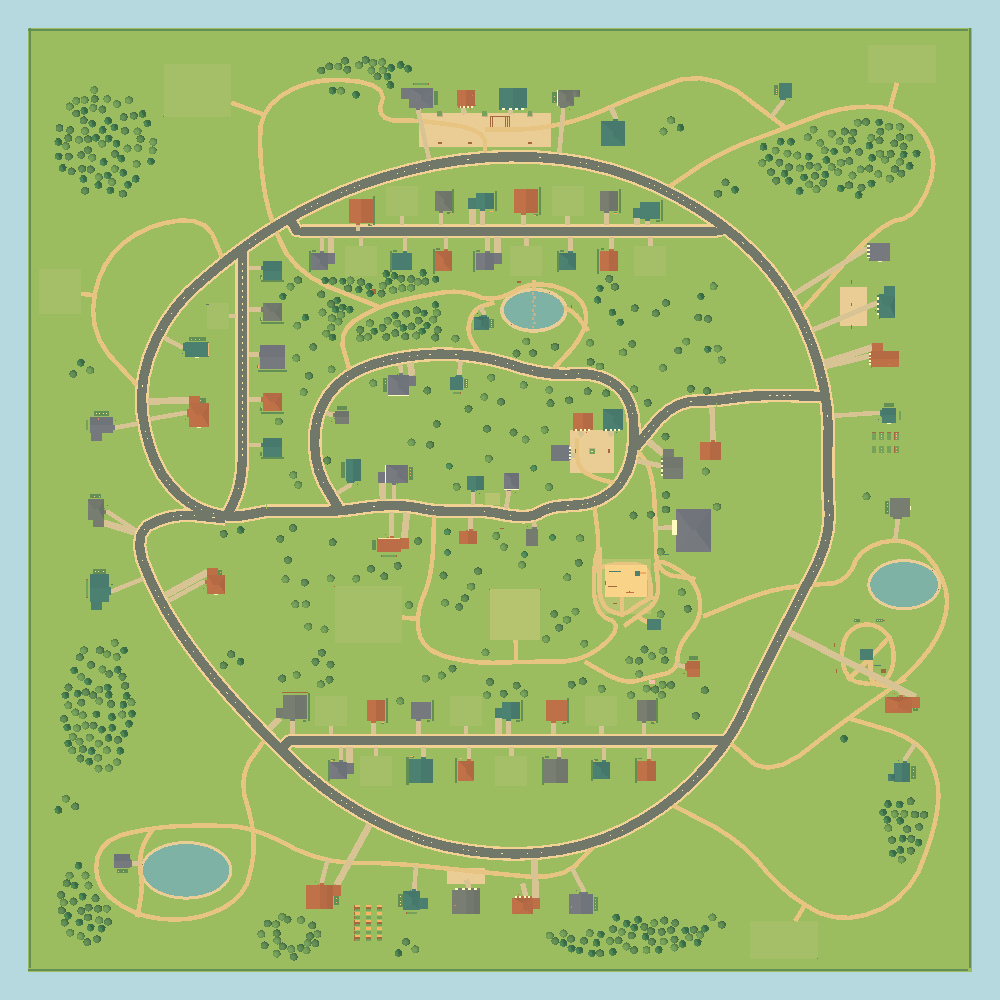

| Linden Street | Elm Lane |
| --- | --- |
| 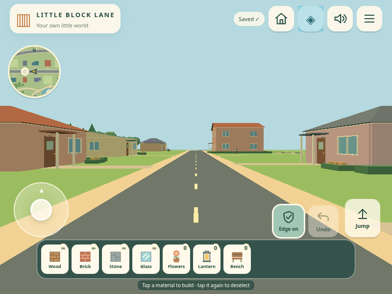 | 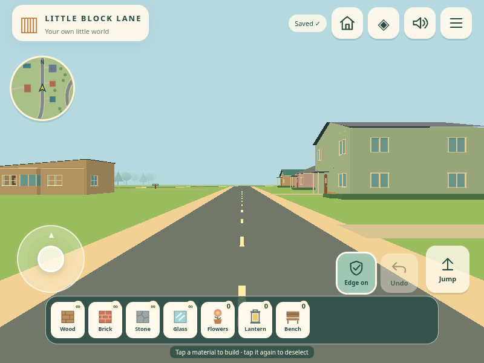 |

| Willow Street | Vacant residential lot |
| --- | --- |
| 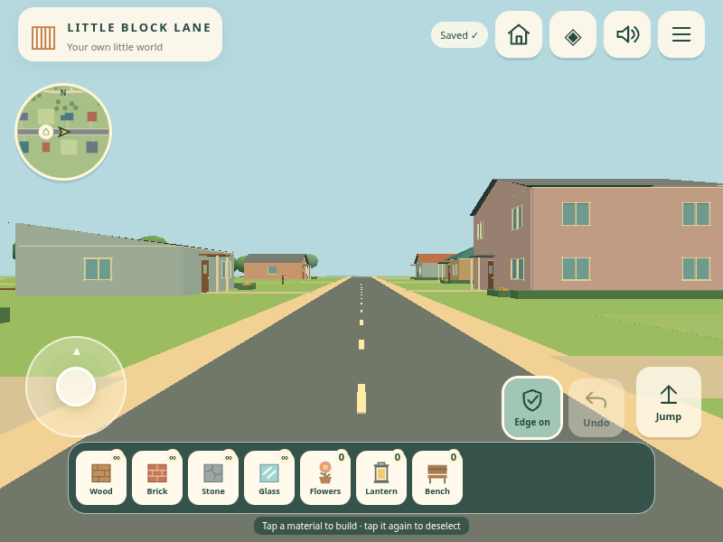 | 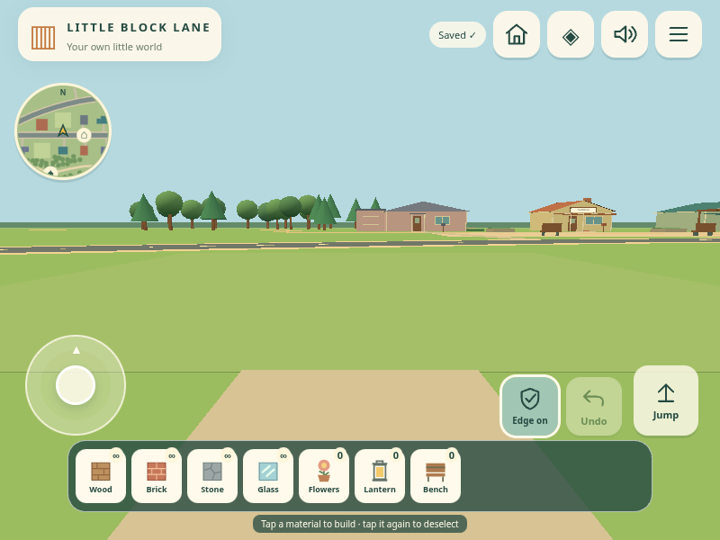 |

| Play park | Lake park |
| --- | --- |
| 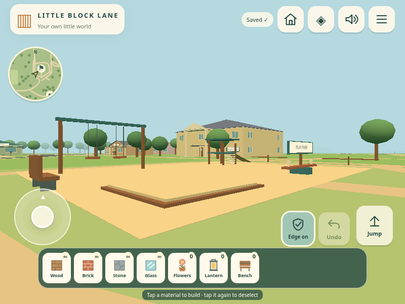 | 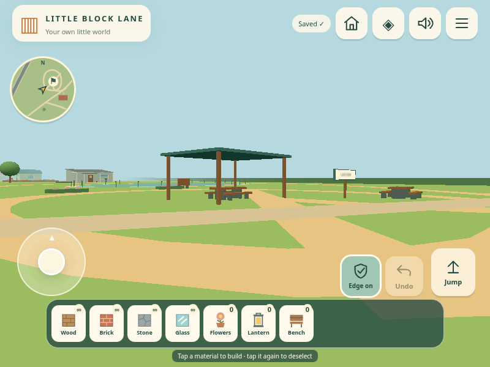 |

| Magnolia manor | Living room |
| --- | --- |
| 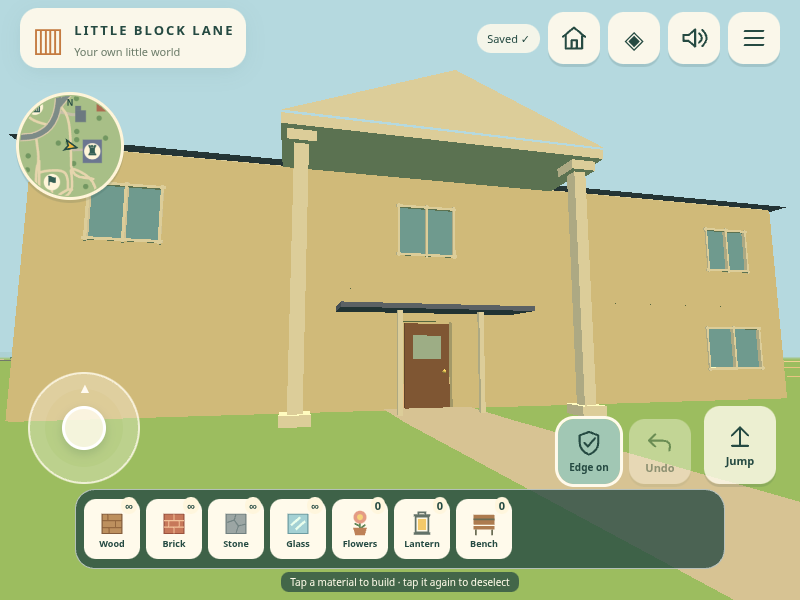 | 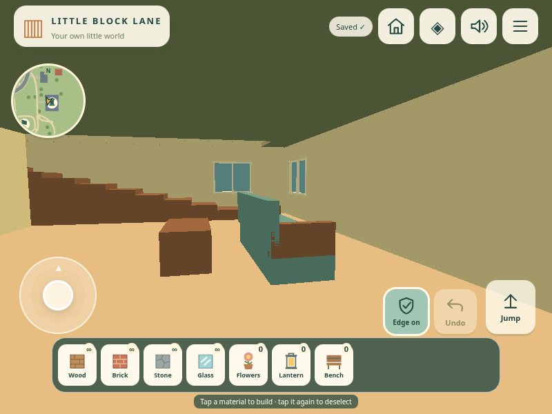 |

| Upstairs | Stairs |
| --- | --- |
| 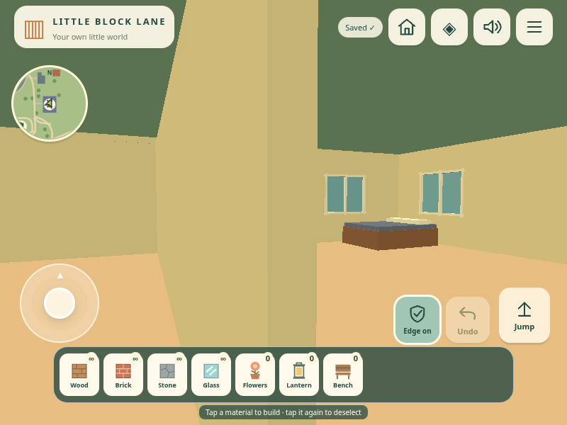 | 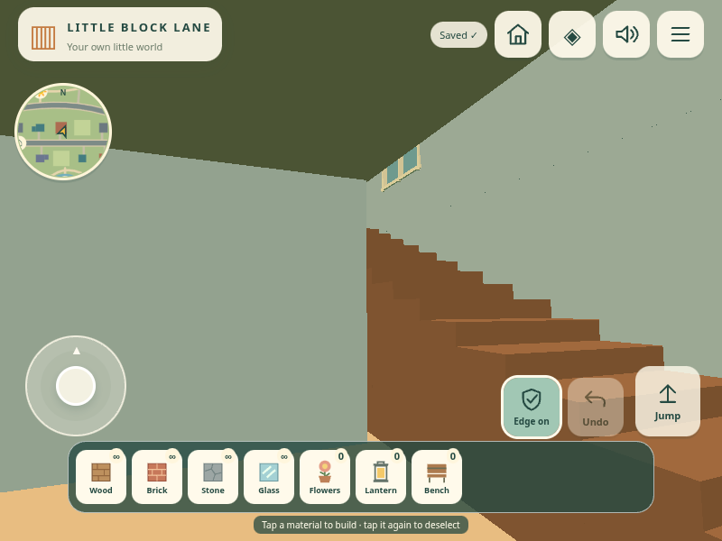 |

| Bay interior in 05 | Shared-model correction in 06 |
| --- | --- |
| 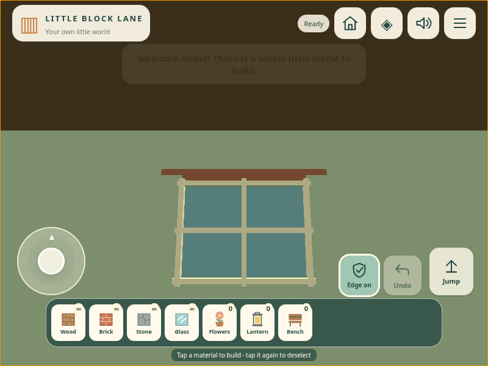 | 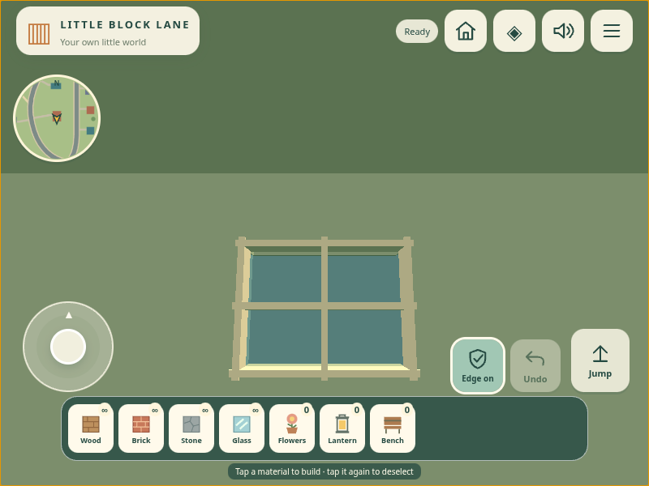 |

| Garage open | Garage closed |
| --- | --- |
| 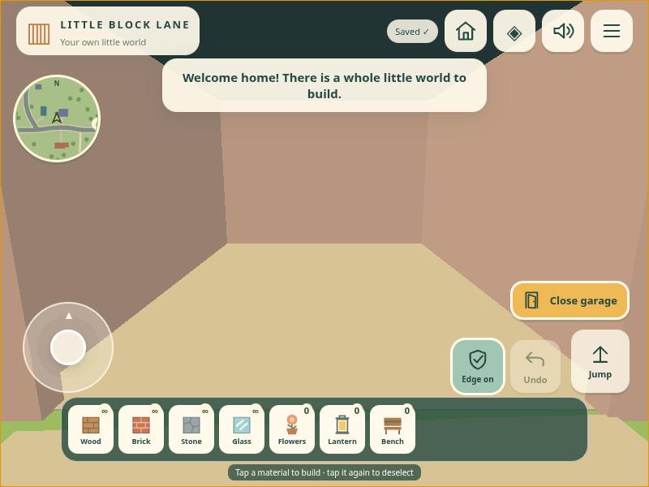 | 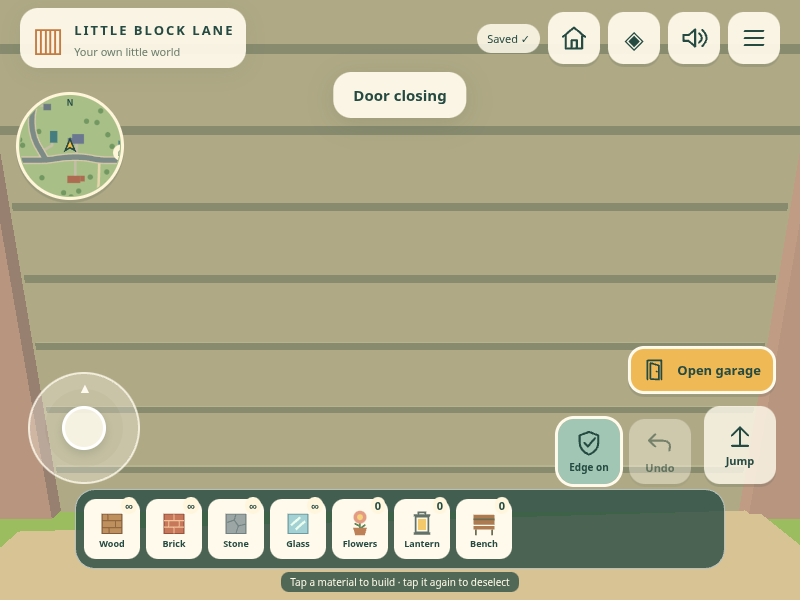 |

| Phone portrait dock/minimap | Phone landscape dock/minimap |
| --- | --- |
| 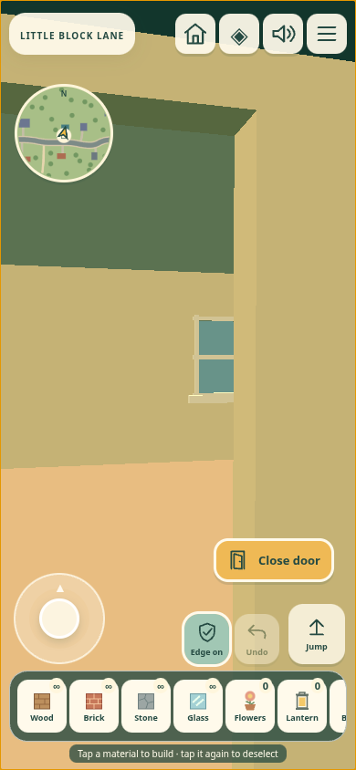 | 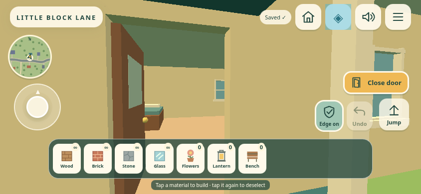 |

[Full map screenshot](screenshots/map.png) · [Tablet dock](screenshots/dock-800.png) · [Play/device checklist](../WORLD_06.md) · [Architecture/defect analysis](../VERIFICATION_06.md) · [CSV](comparison.csv) · [Raw tests](browser.json) · [Save cases](saves.json) · [Feature cases](features.json) · [Fog checks](fog.json)
